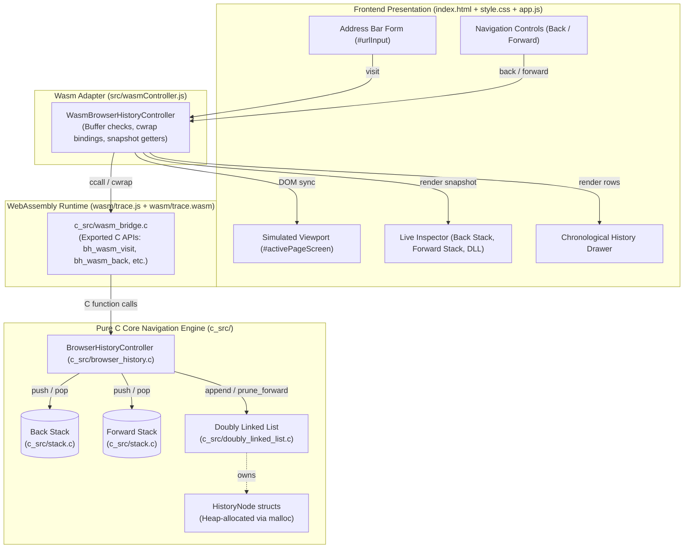

# Trace — Browser History Simulator

[-00599C?logo=c&logoColor=white)](c_src/)
[-654FF0?logo=webassembly&logoColor=white)](wasm/)
[](index.html)
[-brightgreen)](tests/)
[](LICENSE)

> An educational browser navigation simulator developed for undergraduate Data Structures (CIC-209). Demonstrates how web browsers coordinate **Dual LIFO Stacks** and an active **Doubly Linked List** using an authoritative **pure C navigation engine** executed in the browser via **WebAssembly**, complemented by a standalone **native terminal CLI**.

---

## Table of Contents

1. [Project Overview](#project-overview)
2. [Problem Statement](#problem-statement)
3. [Key Features](#key-features)
4. [Data Structures Used](#data-structures-used)
5. [System Architecture](#system-architecture)
6. [Forward History Pruning Algorithm](#forward-history-pruning-algorithm)
7. [Time & Space Complexity Analysis](#time--space-complexity-analysis)
8. [Project Structure](#project-structure)
9. [Getting Started & Usage](#getting-started--usage)
10. [Automated Test Suites](#automated-test-suites)
11. [Mathematical Invariants](#mathematical-invariants)
12. [Known Limitations](#known-limitations)
13. [Academic Context](#academic-context)
14. [License](#license)

---

## Project Overview

When browsing the web, clicking the **Back** and **Forward** buttons feels instantaneous. However, maintaining reversible navigation while preserving session chronology requires a coordinated interplay between two distinct data structures:

1. **Dual LIFO Stacks (`BackStack` and `ForwardStack`):** Deliver $O(1)$ constant-time page transitions during backward and forward navigation.
2. **Doubly Linked List (`DLL`):** Maintains the linear chronological timeline with bidirectional pointer connections, enabling $O(1)$ tail appends and branch severing.

**Trace** implements these algorithms in **pure C**. JavaScript serves purely as an interface adapter—handling DOM events, validating user inputs, and rendering views using snapshots queried from compiled C functions via WebAssembly.

> **Note:** Trace simulates browser history mechanics, address normalization, and visual state transitions. It does not embed a browser rendering engine or fetch live external web pages.

---

## Problem Statement

A browser history engine must satisfy three fundamental operational invariants:
- **Instant Traversal:** Moving backward and forward must execute in $O(1)$ time without searching or shifting array memory.
- **Bidirectional History Inspection:** Users must be able to view the complete history in chronological order from earliest to latest.
- **Branch Invalidation (Pruning):** When navigating backward and subsequently visiting a new URL, the forward path is permanently discarded. The forward stack must be cleared, and all forward nodes must be deallocated from memory.

---

## Key Features

- **Genuine C Data Structures:** Array-backed Stacks (`c_src/stack.c`) and dynamic Doubly Linked List (`c_src/doubly_linked_list.c`) with heap allocations (`malloc`/`free`).
- **WebAssembly Compilation:** Compiled via Emscripten (`wasm/trace.wasm`) to run inside modern web browsers with near-native execution speed.
- **Dual Execution Modes:**
  1. **Web Browser Interface:** Modern, light-themed browser UI with active viewport, real-time Data Structure Inspector, and history drawer.
  2. **Native Terminal CLI:** Standalone menu-driven console application (`trace_cli.exe`) compiled directly with GCC.
- **Live Data Structure Inspector:** Displays:
  - **Back Stack:** Visualized top-to-bottom with a dedicated `TOP` indicator.
  - **Forward Stack:** Visualized top-to-bottom with a dedicated `TOP` indicator.
  - **Doubly Linked List:** Connected cards with `⇄` bidirectional connectors and dynamic `HEAD`, `CURRENT`, and `TAIL` badges.
- **Memory Safety & Guardrails:** Bounded string buffers (<256 bytes for URL, <128 bytes for title), maximum session capacity of 101 nodes, and strict pointer nullification.
- **Exhaustive Automated Testing:** 129 automated tests covering native C execution, WebAssembly bridge exports, adapter validation, and full DOM integration.

---

## Data Structures Used

| Data Structure | Implementation File | Capacity | Memory Ownership | Role in Trace |
| :--- | :--- | :---: | :---: | :--- |
| **Back Stack** | [`c_src/stack.c`](c_src/stack.c) | 100 pointers | Non-owning (borrowed) | Stores immediate backward navigation path (LIFO). |
| **Forward Stack** | [`c_src/stack.c`](c_src/stack.c) | 100 pointers | Non-owning (borrowed) | Stores immediate forward navigation path (LIFO). |
| **Doubly Linked List** | [`c_src/doubly_linked_list.c`](c_src/doubly_linked_list.c) | 101 nodes max | **Sole Owner** (`free()`) | Maintains chronological session timeline from head to tail. |

---

## System Architecture



### Component Breakdown

| Module | Location | Language | Responsibility |
| :--- | :--- | :---: | :--- |
| **`stack.c`** | [`c_src/stack.c`](c_src/stack.c) | C11 | Array-backed LIFO stack with push, pop, peek, overflow/underflow handling. |
| **`doubly_linked_list.c`** | [`c_src/doubly_linked_list.c`](c_src/doubly_linked_list.c) | C11 | Dynamic DLL with `malloc`/`free`, tail appending, and forward branch pruning. |
| **`browser_history.c`** | [`c_src/browser_history.c`](c_src/browser_history.c) | C11 | Coordinates stacks, DLL, and pointer updates during navigation operations. |
| **`wasm_bridge.c`** | [`c_src/wasm_bridge.c`](c_src/wasm_bridge.c) | C11 | Exposes memory-safe indexed getters and actions via Emscripten exports. |
| **`main.c`** | [`c_src/main.c`](c_src/main.c) | C11 | Interactive menu-driven terminal CLI runner for native console testing. |
| **`wasmController.js`** | [`src/wasmController.js`](src/wasmController.js) | ES6 | JavaScript adapter managing Wasm instantiation and UI snapshot queries. |
| **`app.js`** | [`src/app.js`](src/app.js) | ES6 | DOM event handling, URL normalization, keyboard shortcuts, drawer toggles. |

---

## Forward History Pruning Algorithm

When a user navigates backward and subsequently visits a new URL, browsers do not maintain a branching tree; instead, the forward path is permanently discarded. 

### Worked Example:

1. **Visit 1:** Visit `Google` $\to$ DLL: `[Google (Current)]`, Back: `[]`, Forward: `[]`
2. **Visit 2:** Visit `YouTube` $\to$ DLL: `Google ⇄ [YouTube (Current)]`, Back: `[Google]`, Forward: `[]`
3. **Visit 3:** Visit `Wikipedia` $\to$ DLL: `Google ⇄ YouTube ⇄ [Wikipedia (Current)]`, Back: `[Google, YouTube]`, Forward: `[]`
4. **Back 1:** Current moves to `YouTube` $\to$ Back: `[Google]`, Forward: `[Wikipedia]`
5. **Back 2:** Current moves to `Google` $\to$ Back: `[]`, Forward: `[Wikipedia, YouTube]`
6. **New Visit:** Visit `GitHub`
   - **Step A:** Clear `ForwardStack` $\implies$ Forward stack becomes empty.
   - **Step B:** Call `dll_prune_forward(&dll, current)` $\implies$ Sever `Google.next`, freeing `YouTube` and `Wikipedia`.
   - **Step C:** Append `GitHub` to `Google` $\implies$ DLL becomes `Google ⇄ GitHub`.
   - **Result:** `YouTube` and `Wikipedia` are freed from heap memory. Forward navigation is disabled.

```text
Before Pruning:
  [Google] <===> [YouTube] <===> [Wikipedia]
     ^
  (Current)      [---- FORWARD BRANCH DISCARDED & FREED ----]

After Pruning & Visiting GitHub:
  [Google] <===> [GitHub]
                    ^
                 (Current)
```

---

## Time & Space Complexity Analysis

### Time Complexity

| Operation | C Function | Complexity | Technical Explanation |
| :--- | :--- | :---: | :--- |
| **Stack Operations** | `stack_push`, `stack_pop`, `stack_peek` | **$O(1)$** | Fixed array index assignment and `top` increment/decrement. |
| **DLL Append** | `dll_append_node` | **$O(1)$** | Direct update to `list->tail` and `tail->next`. |
| **Back Navigation** | `bh_back` | **$O(1)$** | One stack pop, one stack push, pointer assignment. |
| **Forward Navigation** | `bh_forward` | **$O(1)$** | One stack pop, one stack push, pointer assignment. |
| **Visit (No forward branch)** | `bh_visit` | **$O(1)$** | Single node allocation (`malloc`), stack push, DLL tail append. |
| **Visit (With $f$ forward nodes)**| `bh_visit` | **$O(f)$** | Traverses and calls `free()` on $f$ severed forward nodes during pruning. |
| **Clear History ($n$ nodes)** | `bh_clear` | **$O(n)$** | Traverses Doubly Linked List from `head` and frees all $n$ nodes. |
| **Full UI Snapshot Sync** | Indexed Wasm queries | **$O(n^2)$** | Calling indexed getters $0$ to $n-1$ traverses $O(i)$ per index. For $n \le 101$, takes $<0.1\text{ ms}$. |

### Space Complexity

- **Stack Storage:** $O(C)$ where $C = \text{STACK\_CAPACITY} = 100$ pointers per stack ($2 \times 100 \times 4\text{ bytes} \approx 800\text{ bytes}$).
- **Doubly Linked List Storage:** $O(n)$ where $n$ is active node count ($n \le 101$). Each node occupies 392 bytes on 32-bit Wasm/MinGW.
- **Total C Memory Footprint:** Bounded at $\approx 45\text{ KB}$, with deterministic upper limits and zero runaway growth.

---

## Project Structure

```text
DS_project/
├── .gitignore                         # Git exclusion rules (binaries, caches, logs)
├── .nojekyll                          # Directs GitHub Pages to bypass Jekyll processing
├── index.html                         # Semantic HTML5 layout, icons, and Wasm loader tags
├── style.css                          # Trace visual system design tokens and layout
├── README.md                          # Comprehensive project documentation
├── build-wasm.bat                     # Emscripten WebAssembly compilation script
├── c_src/                             # Pure C Core Navigation Engine
│   ├── stack.h / stack.c              # Fixed-capacity LIFO Stack implementation
│   ├── doubly_linked_list.h / .c      # Dynamic Doubly Linked List implementation
│   ├── browser_history.h / .c         # Coordinating BrowserHistoryController
│   ├── wasm_bridge.c                  # Exported C API for WebAssembly bridge
│   └── main.c                         # Standalone interactive terminal CLI runner
├── wasm/                              # Compiled WebAssembly Output
│   ├── trace.wasm                     # Compiled binary bytecode (8.0 KB)
│   └── trace.js                       # Emscripten modularized JavaScript loader (10.3 KB)
├── src/                               # Frontend Integration & Adapters
│   ├── wasmController.js              # Wasm adapter mediating between UI and C engine
│   ├── app.js                         # DOM event wiring, validation & UI synchronization
│   ├── Stack.js                       # Inactive legacy JS Stack (preserved for regression)
│   ├── Node.js                        # Inactive legacy JS HistoryNode
│   ├── DoublyLinkedList.js            # Inactive legacy JS Doubly Linked List
│   └── BrowserHistoryController.js    # Inactive legacy JS Controller
├── tests/                             # Automated Test Suites (129 Tests Total)
│   ├── c_history_test.c               # Native C automated test suite (27 tests)
│   ├── wasm.test.js                   # WebAssembly C bridge test suite (17 tests)
│   ├── wasmController.test.js         # Wasm adapter interface test suite (8 tests)
│   ├── frontendE2E.test.js            # Frontend DOM integration test suite (15 tests)
│   ├── stack.test.js                  # Legacy JS Stack unit tests (8 tests)
│   ├── doublyLinkedList.test.js       # Legacy JS DLL unit tests (18 tests)
│   ├── browserHistoryController.test.js # Legacy JS Controller unit tests (25 tests)
│   └── integrationVerification.test.js # Legacy JS Invariant test suite (11 scenarios)
└── docs/                              # Academic Reports & Viva Documentation
    ├── c-migration-plan.md            # C & WebAssembly architectural migration plan
    ├── phase-c2-native-engine.md      # Pure C data structures & CLI report
    ├── phase-c3-webassembly.md        # WebAssembly compilation & bridge report
    ├── phase-c4-frontend-integration.md # Frontend & Wasm integration report
    ├── final-c-project-guide.md       # Comprehensive 19-section academic project guide
    └── viva-guide.md                  # 30 viva questions and concise answers
```

---

## Getting Started & Usage

### Prerequisites

- Any modern desktop web browser (Chrome, Edge, Firefox, or Safari).
- **Python 3** (or Node.js) to serve static files locally over HTTP (required for WebAssembly `.wasm` binary loading).
- **MinGW GCC** (optional): to compile and run the native C terminal CLI runner and test suite.
- **Node.js** (v16.0.0 or higher, optional): to run the automated test suites.

### Installation

```bash
git clone https://github.com/your-username/trace-browser-history-simulator.git
cd trace-browser-history-simulator
```

### 1. Running the Web Application (Pure C via WebAssembly)

Due to modern browser security restrictions (CORS) on loading `.wasm` binaries over the `file://` protocol, start a local HTTP server in the project directory:

```bash
# Start a local static HTTP server
python -m http.server 8000
```

Then navigate to:
```
http://localhost:8000
```
*(When deployed to GitHub Pages or any static web host, it runs out-of-the-box over HTTPS without extra setup).*

### 2. Running the Native C Command-Line Application

Trace includes a standalone, interactive terminal CLI built in standard C:

```bash
# Compile native C CLI with GCC
gcc -std=c11 -Wall -Wextra -pedantic c_src/stack.c c_src/doubly_linked_list.c c_src/browser_history.c c_src/main.c -o trace_cli.exe

# Run the CLI
.\trace_cli.exe
```

### 3. Rebuilding the WebAssembly Module (Optional)

If modifying C source files, recompile the WebAssembly assets using Emscripten:

```bash
# Windows
build-wasm.bat
```

---

## Automated Test Suites

Trace features an exhaustive, multi-tier automated test suite covering native C execution, WebAssembly C bridge functions, JavaScript adapter boundaries, end-to-end DOM simulation, and legacy regression suites:

```bash
# 1. Run Native C automated test suite (27 tests)
.\trace_tests.exe

# 2. Run WebAssembly C bridge tests (17 tests)
node tests/wasm.test.js

# 3. Run WebAssembly Controller adapter tests (8 tests)
node tests/wasmController.test.js

# 4. Run Frontend DOM E2E Integration tests (15 tests)
node tests/frontendE2E.test.js

# 5. Run Legacy JavaScript regression suite (62 tests)
node tests/stack.test.js ; node tests/doublyLinkedList.test.js ; node tests/browserHistoryController.test.js ; node tests/integrationVerification.test.js
```

### Complete Test Suite Summary

```text
============================================================
              AUTOMATED MULTI-ENGINE TEST SUMMARY
============================================================
  tests/c_history_test.c (Native GCC C)        27 /  27 PASSED
  tests/wasm.test.js (WebAssembly C Bridge)    17 /  17 PASSED
  tests/wasmController.test.js (Wasm Adapter)   8 /   8 PASSED
  tests/frontendE2E.test.js (DOM E2E)          15 /  15 PASSED
  tests/stack.test.js (Legacy JS Stack)         8 /   8 PASSED
  tests/doublyLinkedList.test.js (Legacy DLL)  18 /  18 PASSED
  tests/browserHistoryController.test.js (Ctrl) 25 /  25 PASSED
  tests/integrationVerification.test.js (Invar) 11 /  11 PASSED
============================================================
  GRAND TOTAL                                 129 / 129 PASSED (100%)
============================================================
```

---

## Mathematical Invariants

The application guarantees that the following architectural invariants hold true after every operation:

1. **Populated State Relation:**
   $$\text{backStack.size}() + \text{forwardStack.size}() + 1 = \text{dll.size}()$$
2. **Back Stack Top Agreement:**
   $$\text{backStack.peek}() \equiv \text{dll.current.prev} \quad (\text{or } \text{current.prev} = \text{NULL} \text{ if BackStack is empty})$$
3. **Forward Stack Top Agreement:**
   $$\text{forwardStack.peek}() \equiv \text{dll.current.next} \quad (\text{or } \text{current.next} = \text{NULL} \text{ if ForwardStack is empty})$$
4. **Boundary Invariants:**
   - At earliest page: `backStack.size() == 0`, `canGoBack == 0`, `dll.current == dll.head`.
   - At latest page: `forwardStack.size() == 0`, `canGoForward == 0`, `dll.current == dll.tail`.

---

## Known Limitations

1. **Fixed History Capacity:** Maximum active history is bounded at 101 nodes (100 in stack + 1 active). Attempts to exceed this capacity are safely rejected without memory corruption.
2. **Local HTTP Server Requirement:** WebAssembly bytecode cannot be loaded over `file:///` in modern browsers due to CORS security policies; a local HTTP server or GitHub Pages is required.
3. **Simulation Scope:** Trace accurately models browser navigation history algorithms and metadata; it does not render external websites or execute external JavaScript.

---

## Academic Context

- **Course:** CIC-209 – Data Structures
- **Institution:** Bhagwan Parshuram Institute of Technology (BPIT), GGSIPU, Delhi
- **Department:** Department of Information Technology

---

## License

This project is licensed under the [MIT License](LICENSE).
