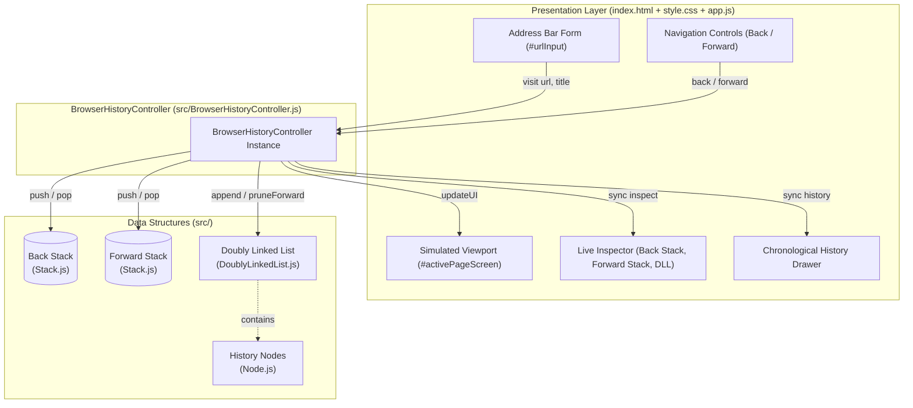

# Trace — Browser History Simulator

[-f7df1e?logo=javascript&logoColor=black)](src/)
[-success)](index.html)
[-blue)](index.html)
[-brightgreen)](tests/)
[](LICENSE)

> A polished, client-side browser navigation simulator demonstrating how modern web browsers manage navigation history using **Dual Stacks (LIFO)** and an active **Doubly Linked List**.

---

## Table of Contents

1. [Project Overview](#project-overview)
2. [Key Features](#key-features)
3. [Core Data Structures & Architecture](#core-data-structures--architecture)
4. [Forward History Pruning Algorithm](#forward-history-pruning-algorithm)
5. [Time & Space Complexity Analysis](#time--space-complexity-analysis)
6. [Project Structure](#project-structure)
7. [Getting Started & Usage](#getting-started--usage)
8. [Automated Test Suite](#automated-test-suite)
9. [Mathematical & Architectural Invariants](#mathematical--architectural-invariants)
10. [Academic Context](#academic-context)
11. [License](#license)

---

## Project Overview

When browsing the web, clicking the **Back** and **Forward** buttons feels instantaneous and intuitive. However, the underlying mechanics require a coordinated interplay between two distinct data structures:

1. **Dual Stacks (Back Stack & Forward Stack):** Handle the immediate, reversible navigation path ($O(1)$ transitions).
2. **Doubly Linked List (DLL):** Maintains the full, chronological active session timeline with bidirectional traversal ($O(1)$ link modifications).

**Trace** is an offline, zero-dependency browser utility that accurately models this behavior. Built with Vanilla JavaScript, HTML5, and CSS3, it provides a clean browser-inspired interface along with an on-demand **Data Structure Inspector** that renders stack states, pointer movements, and timeline pruning in real time.

---

## Key Features

- **Realistic Browser Experience:** Address bar input with automatic URL normalization, quick-access shortcuts, active webpage viewport with authentic site marks, and contextual status feedback.
- **Dual-Stack Navigation Engine:** Independent `BackStack` and `ForwardStack` coordinating instant backward and forward page transitions.
- **Active Doubly Linked List Timeline:** Chronological session history allowing forward and backward traversal via bidirectional node references.
- **Branch Pruning Visualization:** Opening a new webpage after navigating backward cleanly severs the forward timeline branch, clears the Forward Stack, and updates the display in real time.
- **Live Data Structure Inspector:** On-demand drawer showing:
  - **Back Stack:** Visualized top-to-bottom with a dedicated `TOP` marker.
  - **Forward Stack:** Visualized top-to-bottom with a dedicated `TOP` marker.
  - **Doubly Linked List:** Connected node cards linked with `⇄` arrows, dynamically marked with non-overlapping `HEAD`, `CURRENT`, and `TAIL` badges.
- **Strict Input Validation & Security:** Custom hostname validator that rejects malformed domains (e.g. `foo..bar`), unsupported protocols (`ftp:`, `file:`, `javascript:`), HTML injection (`<script>`), and arbitrary text.
- **Keyboard Navigation:** Submit URLs with <kbd>Enter</kbd> and dismiss drawers instantly with <kbd>Escape</kbd>.
- **100% Offline & Portable:** Runs natively via the `file://` protocol in any desktop browser. No Node.js runtime, build tools, external CDNs, or npm dependencies required.

---

## Core Data Structures & Architecture

### System Architecture Diagram



### Component Breakdown

| Class / Module | File Location | Responsibility |
| :--- | :--- | :--- |
| **`Stack`** | [`src/Stack.js`](src/Stack.js) | Array-backed LIFO stack implementation providing `push()`, `pop()`, `peek()`, `isEmpty()`, `size()`, `clear()`, and `toArray()`. |
| **`HistoryNode`** | [`src/Node.js`](src/Node.js) | Individual timeline node storing `url`, `title`, `timestamp`, `prev` pointer, and `next` pointer. |
| **`DoublyLinkedList`** | [`src/DoublyLinkedList.js`](src/DoublyLinkedList.js) | Manages linear chronological timeline with `head`, `tail`, and `current` pointers. Features `append()`, `pruneForward()`, `toArray()`, and `clear()`. |
| **`BrowserHistoryController`** | [`src/BrowserHistoryController.js`](src/BrowserHistoryController.js) | Single authoritative controller coordinating stack transfers, current node updates, and branch pruning. |
| **`app.js`** | [`src/app.js`](src/app.js) | DOM event wiring, URL validation, safe DOM synchronization, keyboard handling, and drawer management. |

---

## Forward History Pruning Algorithm

When a user navigates backward and subsequently visits a new URL, browsers do not maintain a branching tree; instead, the forward path is permanently discarded. 

### Worked Example:

1. **Visit 1:** Visit `Google` $\to$ DLL: `[Google (Current)]`, Back: `[]`, Forward: `[]`
2. **Visit 2:** Visit `YouTube` $\to$ DLL: `Google ⇄ [YouTube (Current)]`, Back: `[Google]`, Forward: `[]`
3. **Visit 3:** Visit `Wikipedia` $\to$ DLL: `Google ⇄ YouTube ⇄ [Wikipedia (Current)]`, Back: `[Google, YouTube]`, Forward: `[]`
4. **Back Operation 1:** Current moves to `YouTube` $\to$ Back: `[Google]`, Forward: `[Wikipedia]`
5. **Back Operation 2:** Current moves to `Google` $\to$ Back: `[]`, Forward: `[Wikipedia, YouTube]`
6. **New Visit:** Visit `GitHub`
   - **Step A:** Clear `ForwardStack` $\implies$ Forward stack becomes empty.
   - **Step B:** Call `dll.pruneForward(current)` $\implies$ Sever `Google.next`, detaching `YouTube ⇄ Wikipedia`.
   - **Step C:** Append `GitHub` to `Google` $\implies$ DLL becomes `Google ⇄ GitHub`.
   - **Result:** `YouTube` and `Wikipedia` are pruned from active history. Forward button is disabled.

```text
Before Pruning:
  [Google] <===> [YouTube] <===> [Wikipedia]
     ^
  (Current)      [---- FORWARD BRANCH DISCARDED ----]

After Pruning & Visiting GitHub:
  [Google] <===> [GitHub]
                    ^
                 (Current)
```

---

## Time & Space Complexity Analysis

| Operation | Implementation Details | Time Complexity | Auxiliary Space | Academic Rationale |
| :--- | :--- | :---: | :---: | :--- |
| **`visit(url, title)`** | Stack push, forward stack reset, DLL pointer severance, append to tail | **$O(1)$ amortized** | $O(1)$ | Array appending in JS is amortized $O(1)$; pointer updates (`current.next = null`) are strictly $O(1)$. |
| **`back()`** | Pop from `BackStack`, push to `ForwardStack`, update `current = current.prev` | **$O(1)$** | $O(1)$ | Direct stack array index pop/push and pointer reassignment require constant time. |
| **`forward()`** | Pop from `ForwardStack`, push to `BackStack`, update `current = current.next` | **$O(1)$** | $O(1)$ | Direct stack array index pop/push and pointer reassignment require constant time. |
| **`clearHistory()`** | Reset stack arrays (`length = 0`), reset DLL pointers to `null` | **$O(1)$** | $O(1)$ | Memory deallocation is delegated to JavaScript garbage collection. |
| **`getHistory()`** | Linear traversal from `head` to `tail` | **$O(N)$** | $O(N)$ | Traverses each active node once to produce a snapshot array. |
| **`updateUI()`** | DOM generation for Stack pills and DLL cards | **$O(N)$** | $O(N)$ | Rendering $N$ nodes in the visual inspector requires linear DOM operations. |

---

## Project Structure

```text
DS_project/
├── .gitignore                         # Git exclusion rules (OS, editors, logs, node)
├── index.html                         # Semantic HTML5 layout and SVG icons
├── style.css                          # Visual system stylesheet (Trace design tokens)
├── README.md                          # Comprehensive project documentation
├── docs/                              # In-depth architectural phase reports
│   ├── phase-1-architecture.md        # System architecture specification
│   ├── phase-2-stack.md               # Stack implementation & test report
│   ├── phase-3-doubly-linked-list.md  # Doubly Linked List implementation report
│   ├── phase-4-browser-navigation.md  # Controller integration report
│   ├── phase-5-frontend.md            # Trace light-themed visual design specification
│   ├── phase-6-integration.md         # UI and engine integration verification
│   └── phase-7-testing.md             # Functional verification & QA test report
├── src/                               # Core Data Structures & Application Logic
│   ├── Stack.js                       # Array-backed Stack class
│   ├── Node.js                        # Doubly Linked List HistoryNode class
│   ├── DoublyLinkedList.js            # Doubly Linked List class
│   ├── BrowserHistoryController.js    # Integrated navigation engine controller
│   └── app.js                         # UI integration, event wiring & safe rendering
└── tests/                             # Automated Test Suites (Zero Dependencies)
    ├── stack.test.js                  # Stack unit tests (8 tests)
    ├── doublyLinkedList.test.js       # Doubly Linked List unit tests (18 tests)
    ├── browserHistoryController.test.js # Controller unit tests (25 tests)
    └── integrationVerification.test.js # End-to-end functional & invariant tests (11 scenarios)
```

---

## Getting Started & Usage

### Prerequisites

- Any modern desktop web browser (Google Chrome, Microsoft Edge, Mozilla Firefox, or Apple Safari).
- **Optional for testing:** [Node.js](https://nodejs.org/) (v16.0.0 or higher) to execute the automated unit test suites.

### Installation

No packages or dependencies need to be installed. Simply clone or download the repository:

```bash
git clone https://github.com/your-username/trace-browser-history-simulator.git
cd trace-browser-history-simulator
```

### Running the Application

Open `index.html` directly in your web browser:

```bash
# Windows (PowerShell)
Start-Process index.html

# macOS
open index.html

# Linux
xdg-open index.html
```

---

## Automated Test Suite

Trace includes a complete automated testing suite covering unit tests, edge cases, rapid operation stress testing, and mathematical invariant checks. The test suites run in standard Node.js without requiring third-party testing frameworks (such as Jest or Mocha).

To execute all **62 tests** in sequence, run:

```bash
node tests/stack.test.js ; node tests/doublyLinkedList.test.js ; node tests/browserHistoryController.test.js ; node tests/integrationVerification.test.js
```

### Test Suite Summary

```text
============================================================
              AUTOMATED REGRESSION TEST SUMMARY             
============================================================
  tests/stack.test.js                          8 /  8 PASSED
  tests/doublyLinkedList.test.js              18 / 18 PASSED
  tests/browserHistoryController.test.js       25 / 25 PASSED
  tests/integrationVerification.test.js       11 / 11 PASSED
============================================================
  GRAND TOTAL                                 62 / 62 PASSED (100%)
============================================================
```

---

## Mathematical & Architectural Invariants

The application guarantees that the following invariants hold true after every operation:

1. **Populated State Relation:**
   $$\text{BackStack.size}() + \text{ForwardStack.size}() + 1 = \text{activeDLL.size}()$$
2. **Back Stack Top Agreement:**
   $$\text{BackStack.peek}() \equiv \text{current.prev} \quad (\text{or } \text{current.prev} = \text{null} \text{ if BackStack is empty})$$
3. **Forward Stack Top Agreement:**
   $$\text{ForwardStack.peek}() \equiv \text{current.next} \quad (\text{or } \text{current.next} = \text{null} \text{ if ForwardStack is empty})$$
4. **Boundary Pointer Nullability:**
   $$\text{head.prev} = \text{null} \quad \text{and} \quad \text{tail.next} = \text{null}$$
5. **Empty History Invariant:**
   $$\text{BackStack.size}() = 0, \quad \text{ForwardStack.size}() = 0, \quad \text{dll.size}() = 0, \quad \text{current} = \text{null}$$

---

## Academic Context

- **Course:** CIC-209: Data Structures
- **Department:** Information Technology
- **Institution:** Bhagwan Parshuram Institute of Technology (BPIT), Guru Gobind Singh Indraprastha University (GGSIPU)
- **Objective:** Demonstrate practical application of Stacks and Doubly Linked Lists in computer systems and browser architecture.

---

## License

This project is licensed under the [MIT License](LICENSE) — feel free to use it for academic and educational purposes.
